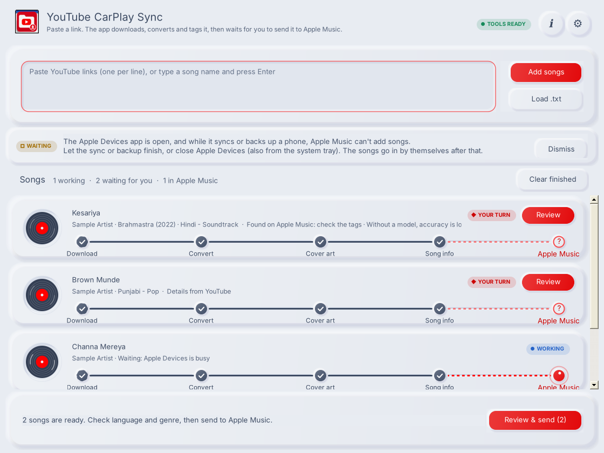
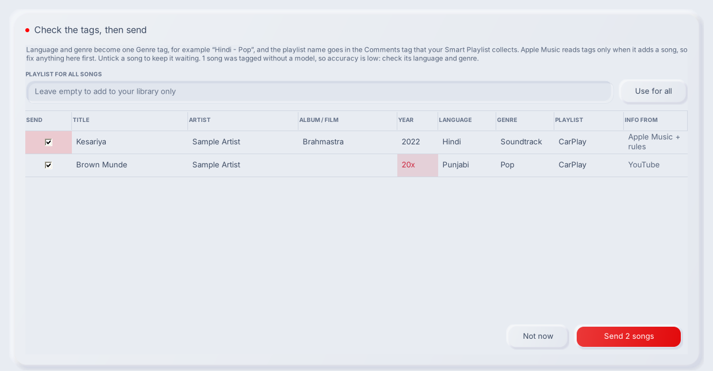
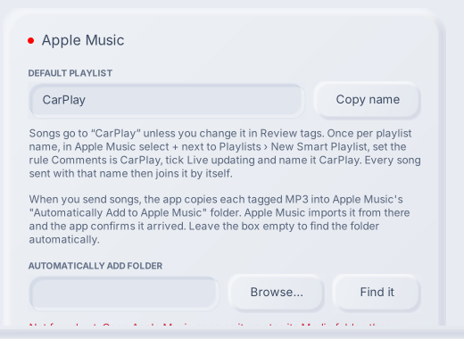
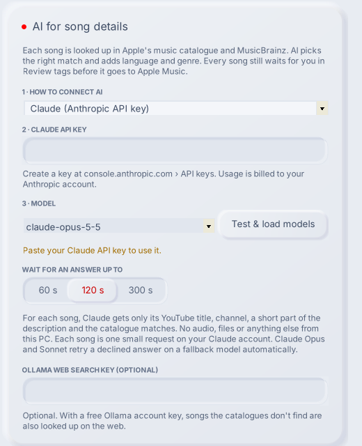

# YouTube CarPlay Sync

A Windows app that turns a YouTube link into a properly tagged MP3 in **Apple Music**, ready for your iPhone and **CarPlay**. Version 1.4.0.

Paste a link: the app downloads the audio, converts it to MP3, adds the official cover art, finds the song's real title, singers, album and year, and lets AI (or built-in rules) add the language and genre. You check the tags, select **Send**, and the song lands in Apple Music and in your playlist.



Use it only for audio you own or have permission to download. Not affiliated with YouTube, Google or Apple.

## Install in three steps

1. Get **YouTube-CarPlay-Sync-Setup.exe**: double-click **Build.cmd** in this folder (see [Build from source](#build-from-source)), or use a copy someone built for you.
2. Double-click it and select **Install app**. Setup downloads yt-dlp, FFmpeg and Deno (about 150 MB) into the app's own folder.
3. Open **YouTube CarPlay Sync** from the Start menu, then do the one-time [playlist setup](#playlists) in Apple Music.

No Python, NuGet or command line is needed. Running a newer installer updates the app and keeps your settings, keys and waiting songs. If setup is offline, the app still installs and shows **Install tools** on its first screen. Prefer to let Claude do it? Give [COWORK-INSTALL-PROMPT.md](COWORK-INSTALL-PROMPT.md) to Claude Cowork on the PC. [Full install, update and recovery guide](docs/INSTALL.md).

## New in 1.4

| What | Details |
|---|---|
| **Default playlist** | Pick one playlist in Settings (for example `CarPlay`). Every song goes there unless you choose another. |
| **Playlist in Review tags** | Set one playlist for every song at the top, or change it per song in the **Playlist** column. |
| **The "i" page** | **i** on the main screen and in Settings (or **F1**) explains every feature, the playlist setup, the AI choices and every send problem. |
| **Any AI, or none** | No AI, Ollama, vLLM, **Claude**, **ChatGPT**, **Gemini** or **Grok**, set up in three steps. Keys are encrypted for your Windows account. |
| **Works without a model** | Built-in rules read the title's script, words like *bhajan* or *remix*, known labels and the catalogue's genre. Songs say **Without a model, accuracy is low**. |
| **Says why a song is stuck** | Apple Devices syncing, iTunes open, Apple Music closed or behind a hidden window, antivirus or OneDrive holding the file, Windows blocking the folder, a full disk: the screen names the cause and the fix. |
| **YouTube red** | `#FF0000` on buttons, the running step and the vinyl label. |

The full list is in the [changelog](CHANGELOG.md).

## How it works

Every song moves through five steps on its own card. The running step pulses red and the vinyl spins.

| Step | What happens |
|---|---|
| **Download** | yt-dlp fetches the best audio YouTube has. A ring shows the percentage. |
| **Convert** | FFmpeg makes an MP3 at the quality you chose (Best by default). |
| **Cover art** | The official 1000×1000 album cover when the catalogue has one, otherwise the video thumbnail. |
| **Song info** | Title, singers, album or film, year and track from Apple's catalogue (MusicBrainz as a fallback). AI picks the right match and adds language and genre; without AI, the built-in rules do. |
| **Apple Music** | Waits at **Your turn** for you to check the tags, then goes into Apple Music. The app confirms it arrived. |

**Adding songs.** Paste one or more YouTube links (one per line, Shorts and YouTube Music links too) and select **Add songs**. Or type a song name, press Enter and pick the right video. **Load .txt** reads a file with one link per line, and **Ctrl+V** anywhere in the window adds what's on the clipboard. A song already in Apple Music isn't added twice, and a link from a mix (`&list=…`) downloads only that one video.

### Review tags



Select **Review & send**. Every waiting song is one row: title, singers, album or film, year, language, genre, **playlist**, and where the details came from. Fix anything here, because Apple Music reads tags only when it adds a song. A year that isn't four digits turns red and holds the send. Untick a song to keep it waiting with your edits. Waiting songs survive closing the app.

Language and genre become one Genre tag, for example `Hindi - Romantic`. The playlist name goes in the song's **Comments** tag.

## Playlists

Apple Music for Windows has no way for other apps to put songs into a playlist. So the app writes the playlist name into each song's **Comments** tag, and a **Smart Playlist** in Apple Music collects them. You set this up **once per playlist name**:

1. In the app: **Settings › Apple Music › Default playlist**, type a name, for example `CarPlay`. **Copy name** copies it.
2. In Apple Music: select **+** next to **Playlists** › **New Smart Playlist**.
3. Set the rule **Comments** · **is** · `CarPlay`, tick **Live updating**, select **OK** and name the playlist `CarPlay`.



Every song sent with that name joins the playlist by itself, now and later, and syncs to your iPhone. For a second playlist, type its name in Review tags and make one more Smart Playlist. Leave the name empty to add songs to your library only.

## AI for song details



Settings › **AI for song details**, in three numbered steps:

1. **How to connect AI**
2. **What that needs:** a server address for a local model, or an API key for a cloud service
3. **Model:** pick one, or select **Test & load models** for the full list

| Choice | You need | Suggested models | Notes |
|---|---|---|---|
| **No AI** | Nothing | | Built-in rules. **Without a model, accuracy is low**: check language and genre before sending. Good for friends without a model. |
| **Ollama** | Ollama running, default `http://127.0.0.1:11434` | `qwen3:30b-a3b`, `gemma3:27b` | Free and private. |
| **vLLM** | Any OpenAI-style server, default `http://127.0.0.1:8000/v1` | Whatever it serves | API key optional. |
| **Claude** | Key from console.anthropic.com › API keys | `claude-opus-5-5` (most accurate), `claude-sonnet-5-5`, `claude-haiku-5-5` (cheapest) | Opus and Sonnet retry a declined answer on a fallback model automatically. |
| **ChatGPT** | Key from platform.openai.com › API keys | `gpt-5.5`, `gpt-5.4`, `gpt-5.4-mini` | Billed separately from a ChatGPT subscription. |
| **Gemini** | Key from aistudio.google.com › Get API key | `gemini-3.5-flash`, `gemini-3.1-flash-lite`, `gemini-2.5-pro` | Google's free tier covers light use. |
| **Grok** | Key from console.x.ai › API keys | `grok-4.7`, `grok-4.3` | |

Cloud usage is billed to your own account with that service. **Wait for an answer up to** sets how long the app waits per song (60, 120 or 300 seconds). If the AI fails for a song, the built-in rules fill in the language and genre so nothing is left blank.

**Ollama web search key** (optional, free from ollama.com › Settings › Keys) adds a web search when Apple's catalogue and MusicBrainz don't know a song. It works with every choice above.

## When songs don't reach Apple Music

Songs go into Apple Music through its **Automatically Add to Apple Music** folder. The app watches each one, and if it doesn't arrive, the main screen says why and what to do. Songs that couldn't be sent go back to **Your turn**.

| What you see | Cause | Fix |
|---|---|---|
| **Apple Devices is busy** | The Apple Devices app is syncing or backing up a phone, which stops Apple Music adding songs. | Let it finish, or close Apple Devices (also from the system tray). Songs go in by themselves after that. |
| **iTunes is open** | iTunes and Apple Music can't add songs at the same time. | Quit iTunes, including from the tray. |
| **Open Apple Music to finish adding it** | Apple Music is closed. | Open it. It adds every waiting song by itself. |
| **Apple Music hasn't taken the song** | Apple Music is open but has added nothing for 3 minutes, usually behind a sign-in, terms or library window. | Switch to Apple Music and answer it. If nothing shows, close Apple Music fully and open it again. If your Music folder is in OneDrive, set the Apple Music folder to **Always keep on this device**. |
| **Another program has the file open** | Antivirus scanning it, or OneDrive syncing it. | Wait a minute, or pause OneDrive or allow the folder in your antivirus. |
| **Windows blocked the Apple Music folder** | Windows Security's **Controlled folder access**. | Windows Security › Virus & threat protection › Ransomware protection: allow YouTube CarPlay Sync. |
| **Import folder wasn't found** | Apple Music hasn't made its Media folder yet, or it's somewhere else. | Open Apple Music once, or choose the folder in Settings › Apple Music. |
| **The disk is almost full** | Less than 300 MB free. | Free some space, then send again. |
| **Not added** | Apple Music moved the file to its *Not Added* folder. | Retry, or add it from Apple Music's menu. |

## iPhone and CarPlay

1. **Sync your iPhone** in the Apple Devices app › Music. Use a cable the first time, then turn on **Show this iPhone when on Wi-Fi** to sync wirelessly. Tick your playlist.
2. **Play in CarPlay**, or ask Siri: "Hey Siri, play my CarPlay playlist."

No Apple Music subscription is needed.

## Settings

| Card | What's there |
|---|---|
| **Audio tools** | Status and version of yt-dlp, FFmpeg and Deno, **Install tools** / **Repair tools**, **Update yt-dlp**, **Open tools folder**. yt-dlp updates itself about once a day. |
| **Downloads** | Save folder (default `Music\YouTube MP3`), MP3 quality, embedded cover art, and Firefox sign-in for videos YouTube won't play signed out. |
| **AI for song details** | How to connect, key or server, model, wait time, optional web search key. |
| **Apple Music** | Default playlist, the *Automatically Add* folder (found automatically), and whether to remove the app's copy once Apple Music has the song. |

## Troubleshooting

- **A download fails.** The song says why (private, age-restricted, members-only, live, removed, bot check, network) and offers **Retry**. When YouTube changes something, the app updates yt-dlp and retries by itself.
- **Language or genre is wrong.** Fix it in Review tags before sending. For better guesses, choose an AI in Settings.
- **A song is already in Apple Music with wrong tags.** Right-click it › **Look up song info again (and re-send)**, then delete the old copy in Apple Music.
- **Claude, ChatGPT, Gemini or Grok says the key is wrong or out of credit.** The message under **Test & load models** says which. Paste a new key; the old one is replaced.
- **A song isn't in the Smart Playlist.** Check its Comments in Apple Music (right-click › Song Info) and that the Smart Playlist's rule matches the name exactly, with **Live updating** ticked.
- **Something else.** Press **F1** for the in-app guide.

## Data and connections

Everything runs on your PC. The app connects to YouTube (download), Apple's catalogue and MusicBrainz (song details and cover art), GitHub (tool updates) and, only if you chose one, your AI service. A cloud AI gets the YouTube title, channel, a short part of the description and the catalogue matches for each song, never audio or files. API keys and the web search key are encrypted with Windows DPAPI for your Windows account and never logged. There is no telemetry.

| What | Where |
|---|---|
| App | `%LOCALAPPDATA%\Programs\YouTube MP3\YouTube-MP3.exe` |
| Settings and encrypted keys | `%LOCALAPPDATA%\YouTubeMP3\models.json` |
| Waiting songs | `%LOCALAPPDATA%\YouTubeMP3\songs.json` |
| Audio tools | `%LOCALAPPDATA%\YouTubeMP3\tools` |
| Downloads | `Music\YouTube MP3`, unless you choose another folder |

## Build from source

On Windows 10 or 11 with .NET Framework 4.8 (built in), double-click **Build.cmd**, or run:

```powershell
powershell -NoProfile -ExecutionPolicy Bypass -File .\build.ps1
```

It builds `dist\YouTube-CarPlay-Sync-Setup.exe` and `dist\YouTube-CarPlay-Sync-Windows.zip` with the .NET Framework compiler that ships with Windows. There are no NuGet packages. The code is C# 5 (WinForms), so that compiler builds it as is.

The checks in `qa/` also run on Linux with Mono:

```sh
mcs -langversion:5 -target:exe -codepage:65001 -main:FeatureTests \
  -r:System.Drawing.dll -r:System.Windows.Forms.dll -r:System.Net.Http.dll -r:System.IO.Compression.dll \
  -r:System.Security.dll -r:System.Web.Extensions.dll -r:System.Xml.Linq.dll \
  -out:features.exe $(ls *.cs | grep -v Installer.cs) qa/FeatureTests.cs
mono features.exe /tmp/ycs-scratch   # rules, Comments tag, every AI service's request, settings migration, send checks
```

## Known limits

- Apple Music for Windows has no public way to add songs to a playlist, so playlists rely on a Smart Playlist matching the Comments tag. Apple's Windows guide documents Smart Playlists but doesn't list every rule field; *Comments* is the rule iTunes offered.
- Apple Music must be running for songs to be added.
- Built-in rules are a fallback: they usually get the language right for Indian-language and English titles, and the genre less often.
- Model names change. **Test & load models** shows what your key can use today.

## References

- [Create a Smart Playlist in Apple Music for Windows](https://support.apple.com/guide/music-windows/mus1712973f4/windows)
- [Sync music with Apple Devices on Windows](https://support.apple.com/guide/devices-windows/mchlbf6a1fab/windows)
- [yt-dlp](https://github.com/yt-dlp/yt-dlp) · [FFmpeg](https://ffmpeg.org) · [MusicBrainz](https://musicbrainz.org)

Not affiliated with or endorsed by YouTube, Google, Apple, Anthropic, OpenAI or xAI. YouTube, Apple Music and CarPlay are trademarks of their owners.
